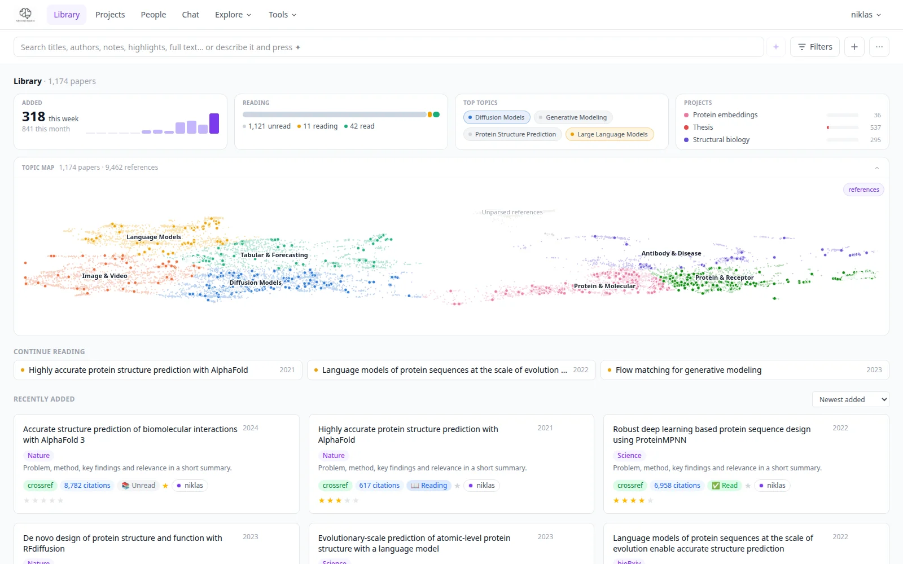
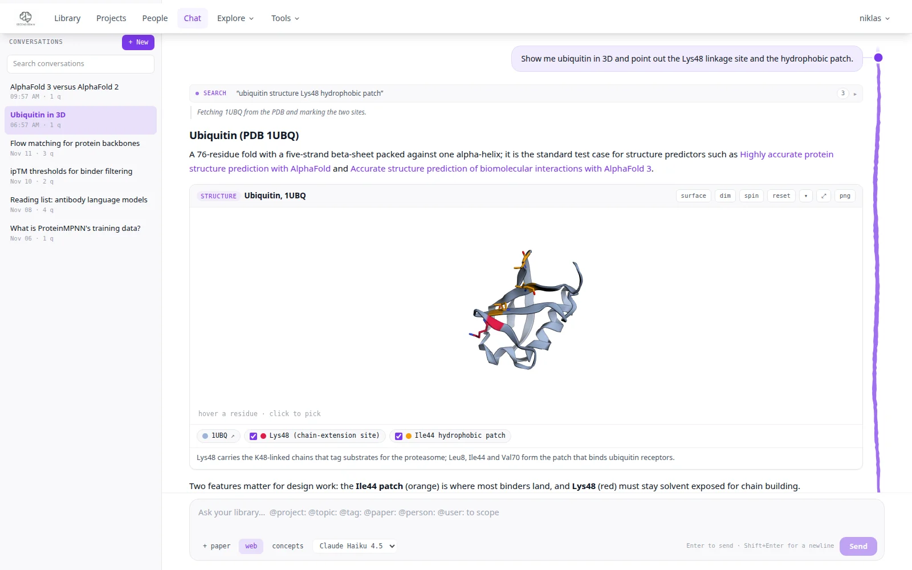
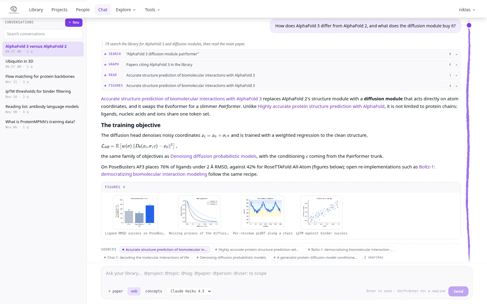
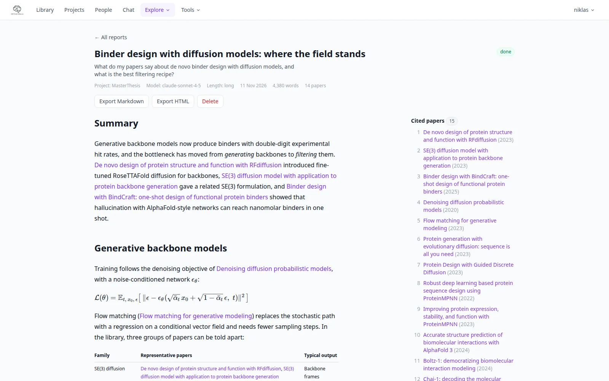
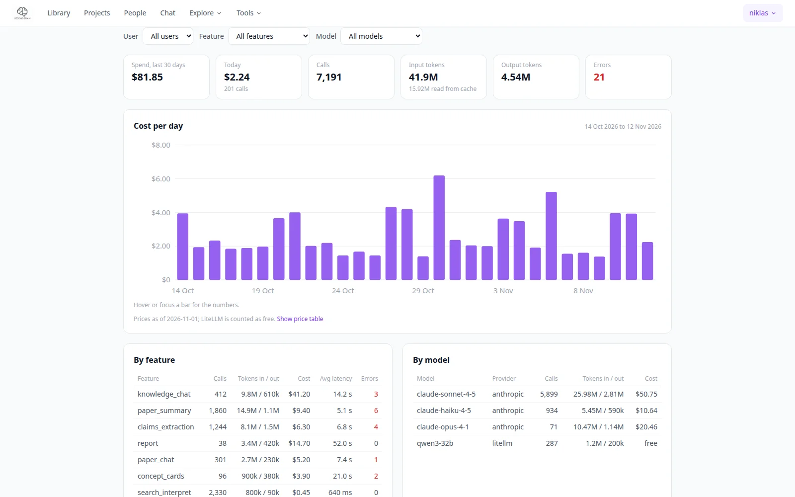
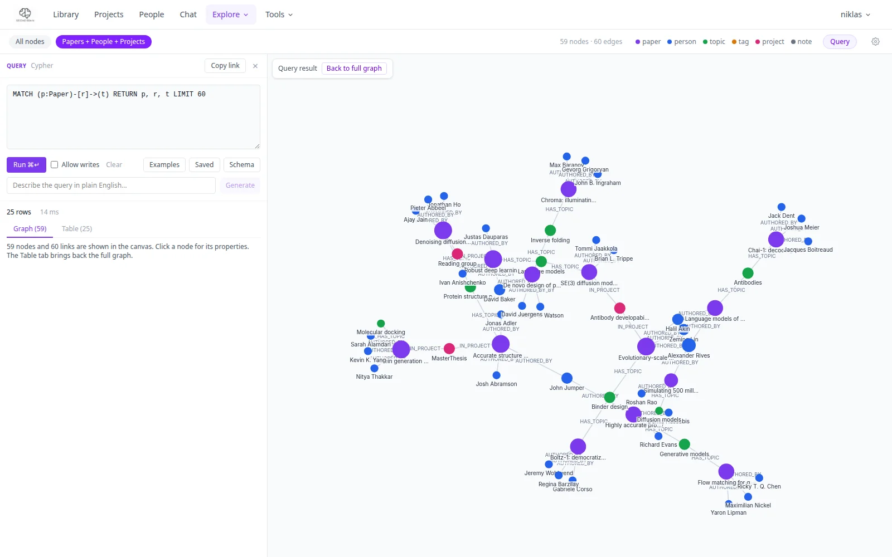
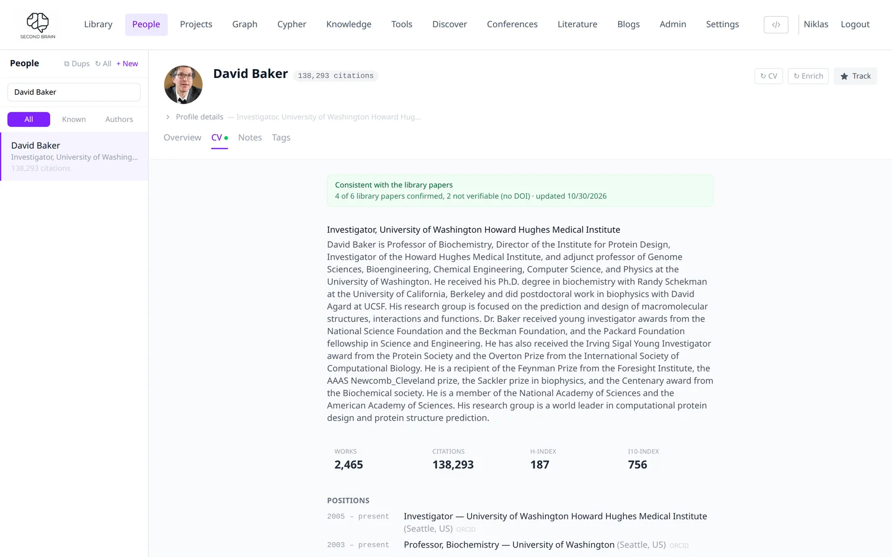
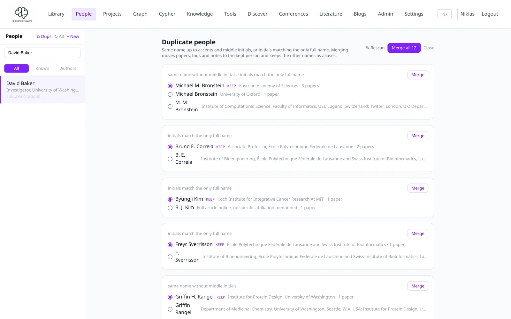

# PaperManager

**A self-hosted second brain for research papers.** Drop in a PDF and PaperManager finds the
metadata, writes a summary, extracts figures and references, draws the ideas on each page as
interactive visualisations, and maps how every paper in a project connects to the others, all in
one Neo4j knowledge graph you can search and chat with.

**[Project page with a full tour](https://niklas-abraham.de/projects/papermanager/)** ·
**[Documentation](https://niklasabraham.github.io/PaperManager/)** ·
**[Set up with your agent](DEPLOY.md)**


### Contributors

Thank you to everyone who has added to PaperManager:

- **[Antoine Luciano](https://github.com/AntoineLuciano)**: researcher CVs, the duplicate-people
  finder and surname order on the People page
  ([#36](https://github.com/NiklasAbraham/PaperManager/pull/36)).

Pull requests are welcome; merged work is credited here, in the
[documentation](https://niklasabraham.github.io/PaperManager/) and on the
[project page](https://niklas-abraham.de/projects/papermanager/#contributions).

---

## Features

| | |
|---|---|
| **Ingestion** | Drop a PDF or paste an arXiv / DOI / PubMed / bioRxiv link. Metadata from Semantic Scholar and CrossRef, duplicate check, then summary, topics, tags, figures, tables and references (every extracted DOI and arXiv id resolved against doi.org and arXiv, dead or wrong ones dropped). Bulk import, literature search and RSS feeds too. |
| **Search** | One box over titles, authors, topics, tags, abstracts, your notes and highlights, claims and full texts, ranked, with the reason for every hit (matched-in chips and marked passages). Type-ahead for papers, authors, topics, tags and projects; typo-tolerant, case- and accent-insensitive; DOIs and arXiv ids; optional meaning-based (embedding) ranking. Filters for date added, year, status, rating, type, project, tag, topic, venue and has PDF / text / note / highlights, all kept in the URL; range indexes and a result cache make browsing 2–3x faster. |
| **Reading** | One view per paper: PDF with colour-coded highlights, AI summary, figures you can ask about, references, related papers, claims, markdown notes that link `@people` and `#topics`. |
| **Concepts** | Finds the ideas on each PDF page that a picture explains best and generates an animation, formula breakdown, plot or explanation for each, marked on the page. Adapted from [Get It.](https://github.com/beltromatti/get-it) (Apache-2.0). |
| **Quick tour** | An overview, what to skip, and 6–12 stops anchored to passages in the PDF. |
| **Project concept map** | Key concepts and their relations across every paper in a project, as an interactive graph filtered by author, year and kind. |
| **Knowledge chat** | Ask across the whole library in a desk-style layout: every tool call is shown as a row, a Sources row under each answer links the papers it used, citations open the paper beside the chat. Figure strips with a lightbox, KaTeX maths with copy-as-TeX, interactive concept cards (formula, plot, animation, short note) and 3D structure cards (PDB, AlphaFold DB, ligands by CCD or PubChem, alignments; [3Dmol.js](https://3dmol.csb.pitt.edu)). Stop and retry, live streaming. Scope with `@project:`, `@topic:`, `@tag:`, `@paper:`, `@person:`, `@user:`; graph-aware, with optional web search. Claude, Claude Code or any OpenAI-compatible model. |
| **Reports** | Ask a question or pick a project and a long read is written from your library in the background: sections, citations that link to your papers, a reference list, export as HTML or Markdown. |
| **Tokens** | A ledger of every LLM call (feature, model, user, tokens, list-price cost) with charts, breakdowns and the most expensive calls and papers. |
| **Suggestions** | The chat proposes improvements to the app as a chip; everyone can submit ideas, vote, and admins set the status. |
| **Health** | Admin page with the state of the backend, Neo4j, AI providers, storage, disk, ingest jobs and background sweepers, plus recent errors. |
| **Conference explorer** | Browse NeurIPS, ICML, ICLR, CVPR, ICCV, ECCV, ACL, EMNLP, AAAI, CoRL and more by institution (rank, research-area mix, collaborators, papers) or by topic (who publishes most on it, closest papers), or search all loaded conferences at once for a paper, an author or where a topic is published. Data from the official conference sites and [Paper Copilot](https://github.com/papercopilot/paperlists), embedded on your own server. |
| **People** | Every author in the library, sorted by surname. A **CV** tab builds a researcher's profile from OpenAlex, ORCID, Wikidata and their homepage (position, education, h-index, most cited works, photo) and checks it against their papers in your library; **⧉ Dups** finds people listed under several spellings and merges them. Contributed by [Antoine Luciano](https://github.com/AntoineLuciano). |
| **MCP server** | 42 tools for Claude Desktop and Claude Code: search, batch-check what is already in the library, read, annotate, upload, merge duplicates, query conferences. |
| **More** | Knowledge graph with a built-in Cypher query panel (result as graph and table), cross-paper synthesis, research-gap finder, author tracking, duplicate merge manager, BibTeX export, multi-user accounts with shared projects. |

<table>
  <tr>
    <td width="50%"><br><sub>Library dashboard</sub></td>
    <td width="50%"><br><sub>Quick tour, stop 2 of 11</sub></td>
  </tr>
  <tr>
    <td width="50%"><br><sub>Concept map of 210 papers</sub></td>
    <td width="50%"><br><sub>Knowledge chat: a cited paper opens beside the answer</sub></td>
  </tr>
  <tr>
    <td width="50%"><br><sub>Concept cards in a chat answer</sub></td>
    <td width="50%"><br><sub>3D structure card (PDB 6VXX)</sub></td>
  </tr>
  <tr>
    <td width="50%"><br><sub>Knowledge chat: tool calls and sources</sub></td>
    <td width="50%"><br><sub>A report written from the library</sub></td>
  </tr>
  <tr>
    <td width="50%"><br><sub>Tokens: what every LLM call cost</sub></td>
    <td width="50%"><br><sub>Graph with the Cypher query panel</sub></td>
  </tr>
  <tr>
    <td width="50%"><br><sub>Researcher CV, checked against the library (by Antoine Luciano)</sub></td>
    <td width="50%"><br><sub>Duplicate people finder (by Antoine Luciano)</sub></td>
  </tr>
</table>

---

## Quick start: let your coding agent set it up

Open [Claude Code](https://claude.com/claude-code), [Codex](https://github.com/openai/codex) or
any other coding agent and say:

> Set up PaperManager for me by following
> https://github.com/NiklasAbraham/PaperManager/blob/main/DEPLOY.md

It asks for your login name, your AI key (Anthropic **or** OpenAI, one is enough), where to keep
PDFs and an accent colour. Then it writes `.env`, starts everything with Docker and checks that
it works. No Google account, GPU or LLM proxy needed. The fast tasks run on Claude Haiku 4.5 or
GPT-5 mini automatically, depending on the key you give it.

### By hand

You need Git, Docker and an [Anthropic](https://console.anthropic.com) or
[OpenAI](https://platform.openai.com/api-keys) API key.

```bash
git clone https://github.com/NiklasAbraham/PaperManager.git
cd PaperManager
cp .env.example .env        # set DEFAULT_USER_NAME, JWT_SECRET_KEY, NEO4J_PASSWORD and one API key
docker compose -f docker-compose.selfhost.yml up -d --build
docker compose -f docker-compose.selfhost.yml exec app python scripts/create_default_user.py
docker compose -f docker-compose.selfhost.yml exec app python scripts/check_setup.py
```

Open **http://localhost:8080**. [DEPLOY.md](DEPLOY.md) explains every choice. The
[self-hosting guide](docs/self_hosting.md) covers Google Drive storage, Heroku and servers.

### Development setup

```bash
conda create -n papermanager python=3.11 -y && conda activate papermanager
pip install -r backend/requirements.txt
cd frontend && npm install && cd ..
cp .env.example .env        # point NEO4J_URI at a running Neo4j 5
./start.sh                  # backend :8000, frontend :5173
```

Tests: `cd backend && pytest` and `cd frontend && npm test`.

---

## Architecture

```
React (Vite, Tailwind) ──► FastAPI ──► Neo4j                        the knowledge graph
MCP clients (Claude)  ──►    │    ──► local disk or Google Drive   PDFs and figures
                             │    ──► Claude / OpenAI / LiteLLM    language models
                             │    ──► Docling                      layout, figures, tables
                             └──► Semantic Scholar · CrossRef · arXiv
```

Prompts live in [`prompts/`](prompts/) as plain text and are reloaded on every call.

---

## Documentation

The full docs are at **[niklasabraham.github.io/PaperManager](https://niklasabraham.github.io/PaperManager/)**
(source in [`docs/`](docs/)).

| User guide | Technical reference |
|---|---|
| [First steps](docs/user-guide/first-steps.md) | [Architecture](docs/technical/architecture.md) |
| [Ingesting papers](docs/user-guide/ingestion.md) | [Backend](docs/technical/backend.md) |
| [Library](docs/user-guide/library.md) | [Frontend](docs/technical/frontend.md) |
| [Paper detail](docs/user-guide/paper-detail.md) | [Data model](docs/technical/data-model.md) |
| [Concepts, tour and concept map](docs/user-guide/reading-tools.md) | [AI pipelines](docs/technical/ai-pipelines.md) |
| [Search and filters](docs/user-guide/search-filters.md) | [Local development](docs/user-guide/getting-started.md) |
| [Knowledge chat](docs/user-guide/chat.md) | [API reference](docs/technical/api-reference.md) |
| [Graph and Cypher panel](docs/user-guide/graph.md) | [Decisions log](docs/decisions.md) |
| [Reports](docs/user-guide/reports.md) | |
| [Tokens](docs/user-guide/tokens.md), [Suggestions](docs/user-guide/suggestions.md), [Health](docs/user-guide/health.md) | |
| [People, projects and export](docs/user-guide/knowledge-features.md) | |
| [MCP server](docs/user-guide/mcp-server.md) | |
| [Conference explorer](docs/user-guide/conferences.md) | |
| [Hosting your own](docs/self_hosting.md) | |

Developer context for working on the code (also used by coding agents) lives in [`.specs/`](.specs/):
[overview](.specs/000_general.md), [architecture](.specs/001_architecture.md),
[data model](.specs/002_data_model.md), [ingestion](.specs/003_ingestion.md),
[AI pipelines](.specs/004_ai_pipelines.md), [knowledge chat](.specs/005_knowledge_chat.md),
[API](.specs/006_api.md), [deployment](.specs/007_deployment.md),
[MCP server](.specs/008_mcp_server.md), [conference explorer](.specs/011_conferences.md),
[search](.specs/012_search.md), [tokens](.specs/013_tokens.md), [reports](.specs/014_reports.md),
[suggestions](.specs/015_suggestions.md), [health](.specs/016_health.md).

---

## Credits

The interactive concepts feature is adapted from [Get It.](https://github.com/beltromatti/get-it)
(Apache-2.0); see [NOTICE](NOTICE).

Built by [Niklas Abraham](https://niklas-abraham.de), with contributions from
[Antoine Luciano](https://github.com/AntoineLuciano) (see [Contributors](#contributors)).
Issues and pull requests are welcome.
