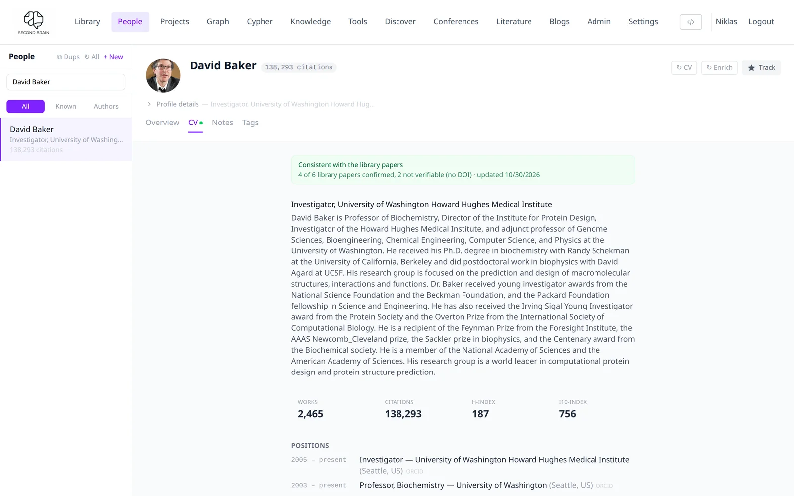
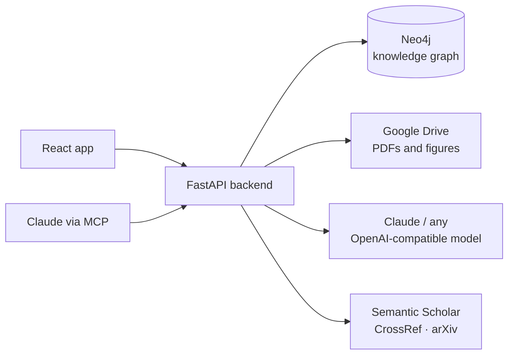

# PaperManager

!!! note "Contributors"
    PaperManager is open source and grows with other people's pull requests. Thank you to
    **[Antoine Luciano](https://github.com/AntoineLuciano)** for researcher CVs, the
    duplicate-people finder and surname order on the People page
    ([#36](https://github.com/NiklasAbraham/PaperManager/pull/36),
    [People guide](user-guide/knowledge-features.md#people)).

## How it works

1

### Add a paper

Drag in a PDF or paste an arXiv, DOI or PubMed link. The metadata is looked up for you;
you check it and press save.

2

### PaperManager reads it

In the background it writes a summary, pulls out figures, tables and references, and
suggests topics and tags.

3

### You read, ask and connect

Read the PDF with the summary, a guided tour and visual explanations beside it, then ask
questions across everything you have read.

New here? [First steps](user-guide/first-steps.md) walks through one paper from upload to
concept map in about ten minutes.

---

## What you get

### One library for every paper

Search titles, authors, your notes and highlights and the full text in one box, ranked, with
every hit showing why it matched; filter by project, topic, tag, author or reading status, and see
at a glance what is still unread.

[Library :octicons-arrow-right-24:](user-guide/library.md)

### A profile for every author

Each researcher gets a CV built from OpenAlex, ORCID, Wikidata and their homepage, checked
against the papers in your library so a namesake is not mistaken for them. People listed under
several spellings are found and merged in one click. Contributed by
[Antoine Luciano](https://github.com/AntoineLuciano).

[People :octicons-arrow-right-24:](user-guide/knowledge-features.md#people)

### Everything about a paper in one view

The left side switches between the PDF, the summary, figures, tables, references and related
papers. The right side keeps your notes, highlights and a chat about the paper open beside
it.

[Reading a paper :octicons-arrow-right-24:](user-guide/paper-detail.md)

### A guided tour through a long paper

An overview, what you can skip, and 6–12 stops that jump to the passages that matter, with
the concepts each one relies on.

[Concepts, tour and concept map :octicons-arrow-right-24:](user-guide/reading-tools.md)

### How a whole project fits together

The key concepts of every paper in a project and how they relate, as a graph you can filter
by author, year and kind of concept.

[Concept map :octicons-arrow-right-24:](user-guide/reading-tools.md#concept-map)

### Ask your whole library

The knowledge chat answers from your papers and cites them; a citation opens the paper
beside the chat. Answers can carry concept cards (formulas, plots, animations) and 3D
protein structures you can rotate. Narrow a question with `@project:`, `@topic:` or
`@paper:`, branch off from any question, or let it search the web too.

[Knowledge chat :octicons-arrow-right-24:](user-guide/knowledge-features.md#knowledge-chat)

### Who publishes what at NeurIPS, ICML, CVPR, ACL, ...

Browse the accepted papers of 22 conference series by institution (rank, research-area mix,
collaborators, every paper) or by topic: type one or paste an abstract and see which
universities and companies publish most on it and the closest papers, one click from your
library. One search box covers all loaded conferences at once: papers, authors, and where a
topic is published, per conference and over the years.

[Conference explorer :octicons-arrow-right-24:](user-guide/conferences.md)

---

## Where to go next

-   :material-rocket-launch:{ .lg .middle } **Install it**

    ---

    Run your own instance with Docker on your computer or on Heroku, with your own
    database and keys.

    [:octicons-arrow-right-24: Hosting your own](self_hosting.md)

-   :material-school:{ .lg .middle } **Learn the app**

    ---

    Upload a paper, read it with the tour, put it in a project and ask questions about it.

    [:octicons-arrow-right-24: First steps](user-guide/first-steps.md)

-   :material-robot-happy:{ .lg .middle } **Use it from Claude**

    ---

    The MCP server gives Claude Desktop and Claude Code 41 tools to search, read and edit
    your library.

    [:octicons-arrow-right-24: MCP server](user-guide/mcp-server.md)

-   :material-code-braces:{ .lg .middle } **Work on the code**

    ---

    How the backend, frontend, graph model and AI pipelines fit together.

    [:octicons-arrow-right-24: Architecture](technical/architecture.md)

---

## Under the hood

Every paper, author, topic, project, note and concept is a node in one Neo4j graph, so the
same data powers the library, the chat, the concept map and the Cypher editor. PDFs stay in
your own Google Drive. More in [Architecture](technical/architecture.md).

PaperManager is open source. The project page at
[niklas-abraham.de](https://niklas-abraham.de/projects/papermanager/) has the story behind
it; issues and pull requests are welcome on
[GitHub](https://github.com/NiklasAbraham/PaperManager).
