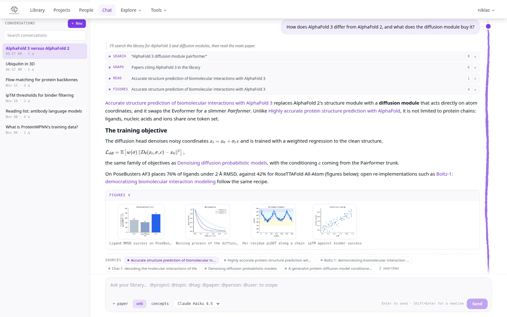
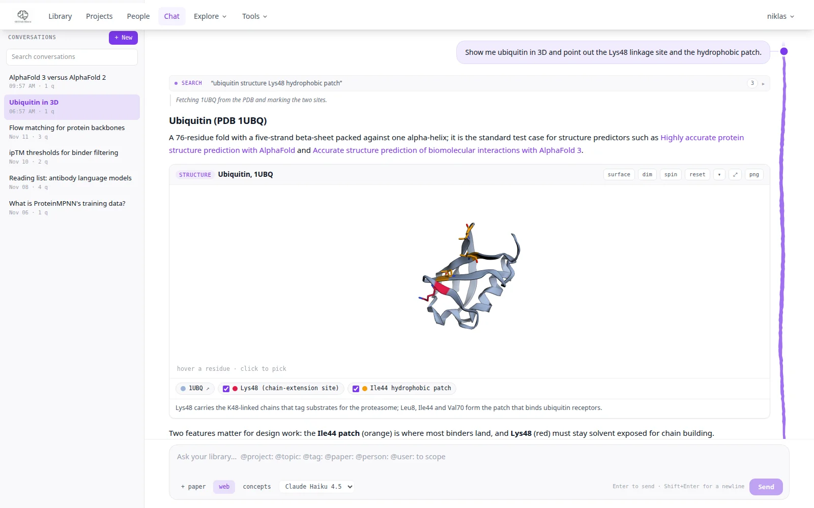
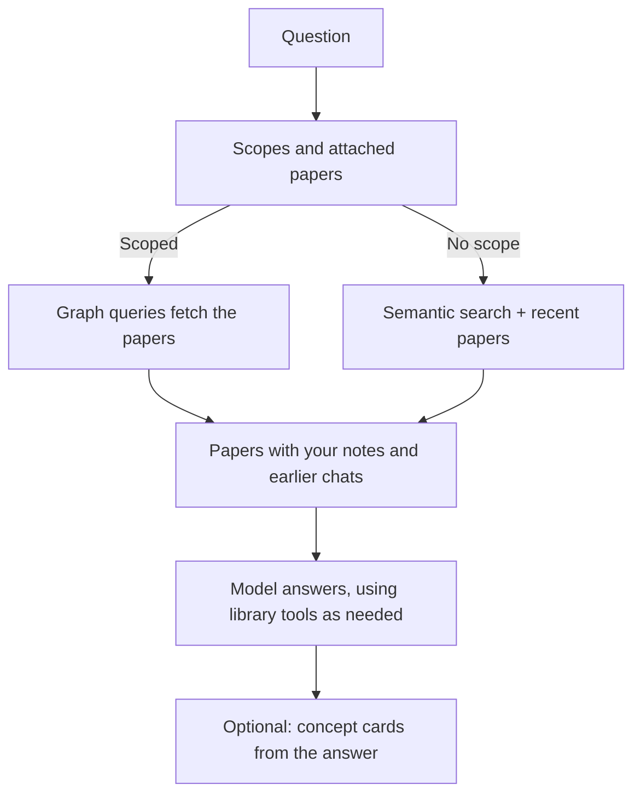

# Knowledge chat

Ask questions across your whole library from **Chat** in the top bar (the page lives at `/knowledge`;
`/chat` redirects there). The answer cites your papers, shows what the model looked up on the way,
and can carry figures, concept cards and 3D structures.

{ .pm-shot }

The page has three parts: your conversations on the left, the chat in the middle, and a preview
pane on the right that opens when you click a cited paper or a figure.

## Asking

Type a question and press Enter (Shift+Enter for a new line). Without a scope, the chat finds relevant papers by
semantic search and adds the most recent ones. To choose the context yourself:

| In the composer | What is loaded |
|----------------|----------------|
| `@project:my-phd-papers` | Papers in that project |
| `@topic:Protein Folding` | Papers about that topic |
| `@tag:deep-learning` | Papers with that tag |
| `@paper:Attention is All You Need` | Papers whose title matches |
| `@person:lecun` | Papers by or involving that person |
| `@user:alice` | Asks a teammate's conversations instead of the library |
| **+ paper** | Attaches one library paper; it is always in context |

Typing `@` suggests projects, topics, tags, people and papers; the scopes you use show as chips above the text. While
the model works, every tool call it makes (graph queries, semantic searches, reading a paper's full text, listing its
figures, searching the web) appears as a compact row above the answer, with a short line of the model's intent between
them where it wrote one; click a row to see what the model sent (the Cypher query, the search terms), a preview of
what came back, and the papers, figures or web pages it touched. The rows are saved with the answer, so a reopened
conversation shows them too. **Stop** ends an answer early and keeps what was written so far; an answer that failed
or was stopped can be asked again with **retry**.

The bar under the text holds **web** (allow web search), **concepts** (make concept cards for every answer),
and the model: Claude with your API key, Claude Code on a Claude subscription (if the server owner enabled it for
you), Claude (Work), or the self-hosted LiteLLM model.

## Answers

Answers render maths, code, tables and figures from your papers. Copying text with formulas gives their LaTeX
(`$...$`, `$$...$$`). Library papers are cited as violet links: click one to open its summary, abstract, figures and
PDF beside the chat, or **Open in library** for the full paper page.

**Sources.** Under each answer a **Sources** row lists the library papers the answer drew on: those it cites, those
whose full text or figures its tools read, those you attached, and then those its searches returned (hover a chip for
which). A click opens the paper beside the chat, Ctrl/Cmd-click opens its page. Web pages it searched follow, then the
number of searches; **N in context** unfolds all papers that were in the model's context.

**Figures.** A single figure of a paper shows full width. Three or more figures in a row (several figures of one
paper, or the same kind of figure across papers) show as a strip of thumbnails; click one for a lightbox (arrow keys
to step, Esc to close, **beside the chat** to keep it open next to the conversation). Asking for "all figures of"
a paper shows its whole figure set as one strip.

**Concept cards.** Press **✦ Visualise** under an answer (or switch **concepts** to auto) and the app finds the ideas
in the answer that a picture would explain, then attaches an interactive card at the end of the section that
discusses each: a formula walked through step by step, a graph, a short sourced note, or an animation with pause,
play, speed (0.25×, 0.5×, 1×, 2×) and replay. Formulas and graphs take about a minute, animations a few. If an animation
breaks, **fix** asks the model to repair it. The cards are saved with the conversation.

**3D structures.** When a question is about a protein or another molecule, the answer can show it in 3D: an
experimental structure from the PDB, an AlphaFold DB prediction coloured by confidence (pLDDT), or a small molecule
(an RCSB ligand code such as ATP, or a PubChem compound) on its own or next to a protein. Structures can be
superposed (the card prints the RMSD), and ensembles play frame by frame. Drag to rotate,
scroll to zoom, hover to name a residue, click residues to collect them; the card has surface, spin, reset,
fullscreen and PNG export, and chips that toggle the highlighted regions. Asking for a structure by its PDB id
("show 6VXX and highlight the receptor-binding domain") works well.

{ .pm-shot }

**Suggestions.** When a session shows that PaperManager lacks something you needed (a missing feature, a tool that
could not do what you asked), the answer can end with a small chip proposing one concrete improvement. It links to
[Suggestions](suggestions.md); the vote button on the chip backs the idea, **×** hides it.

## Conversations and strands

Conversations are saved automatically and listed newest first; search them, rename or delete them on hover, and
start a new one with **+ New**. **compact** summarises older turns to free up context in a long conversation.

Hover one of your questions to fork the conversation: **⑂ edit** starts a copy just before that question with its
text back in the composer, **⑂ strand** continues a copy from that answer. The original stays as it was. Strands
are nested under their conversation in the list, and the line beside the transcript shows where each one left;
click its knob to open it, or the ↑ link above the title to go back.

## Example prompts

```
@topic:Protein Folding How has the approach changed from RoseTTAFold to AlphaFold 3?

Explain the denoising score-matching objective behind diffusion models, with the derivation.

Show the SARS-CoV-2 spike protein (6VXX) in 3D and highlight the receptor-binding domain.

@project:my-phd-papers Summarise the key open problems.
```

## Context

The strip above the chat shows how much of the model's context window the question uses, split into system
prompt, papers, conversation, question and answer. Click it to see which papers are in context.



## Related

- [Reports](reports.md): the same library, written up as a long read with citations.
- [Tokens](tokens.md): what every chat answer cost.
- [Graph](graph.md): the library as a network, and the Cypher query panel the chat's graph tool is modelled on.
