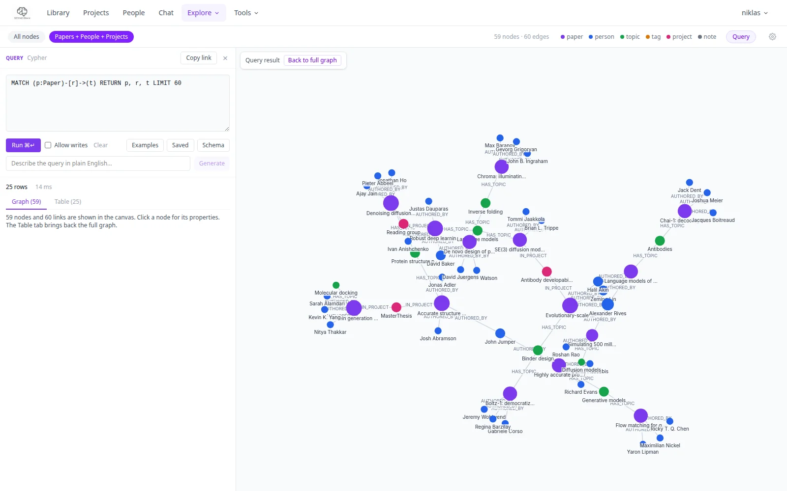

# Graph

**Explore → Graph** shows your whole library as an interactive WebGL network. Admins also get a
**Query** panel on the same page that runs Cypher against the database and shows the result as a
graph and as a table.

## The graph

### Node types

| Colour | Node type |
|--------|-----------|
| Purple | Paper |
| Blue | Person |
| Green | Topic |
| Orange | Tag |
| Pink | Project |
| Grey | Note |

### Controls

- **Pan**: click and drag the background
- **Zoom**: scroll or pinch
- **Move nodes**: drag individual nodes
- **Click a node**: opens a properties panel on the right with all node properties, a link to the
  paper page and, for admins, a delete button

### Modes

| Mode | What is shown |
|------|---------------|
| **Full graph** | All node types (up to 500 nodes) |
| **Papers only** | Papers, People, Topics |
| **Single paper** | One paper with all its direct neighbours |

Switch modes with the toggle in the top-left of the graph. The sliders and toggles in the control
panel change node size, link distance, repulsion and whether node and edge labels are shown.

## Query panel (Cypher)

There is no separate Cypher page any more: the editor is part of the Graph page, and the old
`/cypher` address redirects to `/graph?view=query` (keeping `?q=`). Admins click **Query** in the Graph
top bar (or open `/graph?view=query`); the panel sits beside the graph on wide screens and below it on
phones. Other users see the graph only.

{ .pm-shot }

### Running a query

Write Cypher in the editor and press **Run** (or Ctrl/Cmd+Enter). One run feeds two views:

- **Graph** tab: every node, relationship and path in the result is drawn in the main canvas, replacing
  the full graph. **Back to full graph** (or the Table tab) brings the full graph back.
- **Table** tab: the rows, with mutation counters (nodes created or deleted, relationships created or
  deleted, properties set) and the run time. At most 500 rows are returned; the graph view holds up to
  5,000 nodes.

A result without nodes opens on the Table tab.

### Read-only by default

Queries run in a read-only transaction: Neo4j itself rejects `CREATE`, `MERGE`, `SET` and `DELETE`. Tick
**Allow writes** to run a query that changes the library (a confirmation appears the first time). Writes
cannot be undone.

### Examples, saved queries, schema, sharing

- **Examples**: a grouped list of ready-made queries (graph views, discovery, data quality, cleanup and
  more) that fill the editor.
- **Saved**: store the current query under a name; saved queries live in this browser (localStorage).
- **Schema**: a live view of node labels, relationship types and property keys per label.
- **Copy link**: builds a `/graph?view=query&q=<cypher>` address that opens the panel with that query.
- **Generate** (AI assist): describe what you want in plain English and the model writes the Cypher into
  the editor. Review it, then run it.

### Example queries

```cypher
-- Papers citing a specific paper
MATCH (a:Paper)-[:CITES]->(b:Paper {title: "..."})
RETURN a.title, a.year

-- Most connected authors
MATCH (p:Person)<-[:AUTHORED_BY]-(paper:Paper)
RETURN p.name, count(paper) AS papers ORDER BY papers DESC LIMIT 10

-- Papers without summaries
MATCH (p:Paper) WHERE p.summary IS NULL RETURN p.title, p.year

-- All papers on a topic
MATCH (p:Paper)-[:ABOUT]->(t:Topic {name: "Transformers"})
RETURN p.title, p.year ORDER BY p.year DESC

-- Papers shared by a colleague
MATCH (person:Person {name: "Jan"})<-[:INVOLVES {role: "shared_by"}]-(p:Paper)
RETURN p.title, p.year
```

The API behind the panel is `POST /graph/query`; see the [API reference](../technical/api-reference.md#search-graph-stats).
