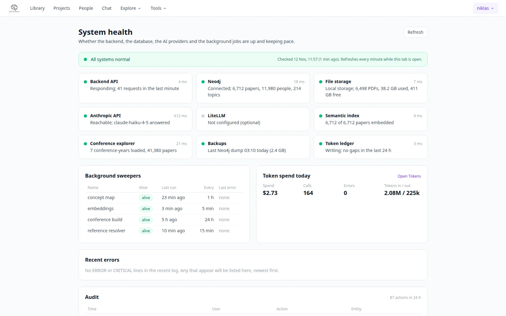

# Health

**Account menu → Health** (`/health`, admins only) shows whether the instance is up, configured and keeping
pace, on one page.

{ .pm-shot }

## The checks

Each check is a card with a status: ok, warning, error, or off (not configured, which is not an error).
The banner at the top is the worst of them.

| Check | What it looks at |
|---|---|
| Backend | the API process, uptime and version |
| Neo4j | connection latency and the number of nodes and relationships per label |
| AI providers | one card per provider (Anthropic, Anthropic work gateway, OpenAI, LiteLLM, Claude Code): configured, which one runs the fast tasks, reachable. The probe lists models and spends no tokens |
| Storage | Google Drive or local files: credentials, access, free space |
| Disk | free space for the files, data and log folders; warning from 85 % used, error from 95 % |
| Ingest | uploads and reference imports pending, running or failed, and when a paper was last added |
| Jobs | concept-map builds, papers that failed mapping, reports running or failed in 24 hours, tours with errors |
| Background sweepers | the concept-map sweeper, library embeddings and conference builds: alive, last run, last error |
| Tokens | today's calls, errors and spend from the [ledger](tokens.md) |

Below the cards: **Recent errors** (the last ERROR and CRITICAL lines of the log, newest first), an **Audit**
summary of the last 24 hours, and the version (git commit, start time).

Results are cached per check for between 10 seconds and 10 minutes, so reloading the page is cheap; the
refresh button recomputes all of them. The load-balancer probe `GET /health` is separate and unchanged.
