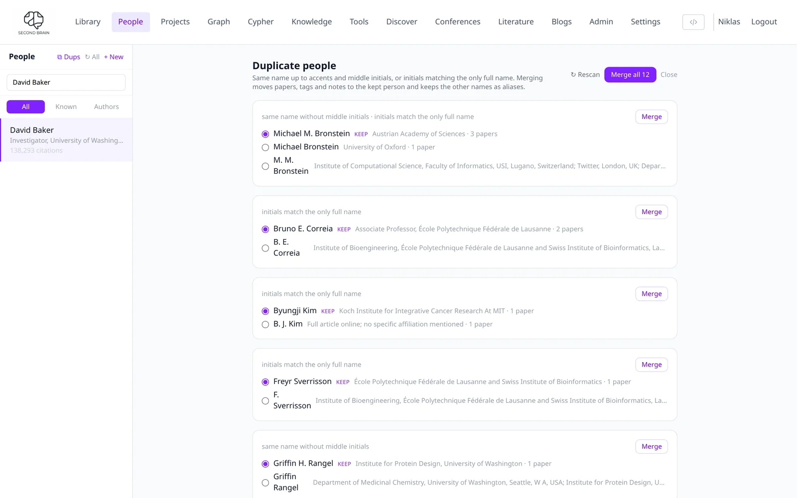

# People, projects and export

The knowledge chat and the graph have their own pages: [Knowledge chat](chat.md) and [Graph](graph.md).
This page covers the people and projects pages and exporting your data.

---

## People

Navigate to **People** in the nav bar.

!!! info "Contributed by Antoine Luciano"
    Surname order, the CV tab and the duplicate finder come from
    [Antoine Luciano](https://github.com/AntoineLuciano)
    ([#36](https://github.com/NiklasAbraham/PaperManager/pull/36)).

All people in the system are listed in the sidebar with search, sorted by surname
("Christian P. Robert" under R; a particle stays with the given names, so "Aad van der Vaart" is under V).

**Person detail** shows:

- Name and affiliation
- Papers where they are an **author** (`AUTHORED_BY`)
- Papers where they have an **INVOLVES role** (shared_by, working_on, collaborating, etc.)
- **Research specialties** (linked `Topic` nodes via `SPECIALIZES`)

- **CV** tab: current position, education, past affiliations, h-index, citations, topics and most
  cited works, built by **↻ CV** from OpenAlex, ORCID, Wikidata (photo, homepage) and the person's
  homepage. Before trusting a profile it checks the person is really an author of their papers in
  the library; a profile found by name alone is accepted only if it lists one of those papers,
  since common names have many homonyms. The status dot says how it went: green (consistent with
  the library papers), amber (mostly), red (probably a homonym or a wrong author link), grey (no
  profile found).

  **Settings → People** chooses the model that reads homepages (**CV model**: the server's fast
  model, e.g. Gemma via LiteLLM, or Claude Haiku / Opus on your Anthropic key) and has
  **Build missing CVs**, which builds a CV for every author without one, in the background and a
  few seconds apart. The profile data itself comes from OpenAlex, ORCID and Wikidata and needs no key.

People are auto-created when papers are ingested from the author list.

### Duplicate people

The same researcher often arrives under several spellings ("Alán Aspuru-Guzik" and
"Al'an Aspuru-Guzik", "Nele P. Quast" and "Nele Quast", "C. P. Robert" and "Christian P. Robert").
**⧉ Dups** at the top of the sidebar lists the groups that look like one person, with the rule
that linked them. Pick which one to keep (the one with a Semantic Scholar id or the most papers
is preselected) and **Merge**, or **Merge all**. The kept person gets every paper, tag and note
of the others, fills its empty fields from theirs, and keeps their names as aliases. An initial
is joined to a full name only when one full name fits ("C. Robert" stays alone next to both
"Christian Robert" and "Claire Robert"). `backend/scripts/merge_people.py` applies the same rules
from the command line.

---

## Projects

Navigate to **Projects** in the nav bar.

Create named collections of papers:

- Create a project with name, description, and status (`active` / `paused` / `done`)
- Add/remove papers from a project
- Papers can belong to multiple projects
- Filter the library by project
- Link projects as related (`RELATED_TO`)
- Select a project during upload, URL ingest, or bulk import to add papers automatically

---

## Export & Backfill

### Export

| Format | How |
|--------|-----|
| **BibTeX** | `GET /export/bibtex` — downloads a `.bib` file containing all papers |
| **JSON** | Available from the Settings page |

### Backfill (Bulk Enrichment)

Run from the Settings page or directly via the API:

| Operation | Endpoint | Description |
|-----------|----------|-------------|
| Backfill topics | `POST /backfill/topics` | Run Claude Haiku topic suggestion on all papers without topics |
| Backfill summaries | `POST /backfill/summary` | Generate AI summaries for papers that have `raw_text` but no summary |
| Backfill figures | `POST /backfill/figures` | Extract figures from all papers that have a PDF but no figures yet |

Each returns `{processed, skipped, errors}`.
