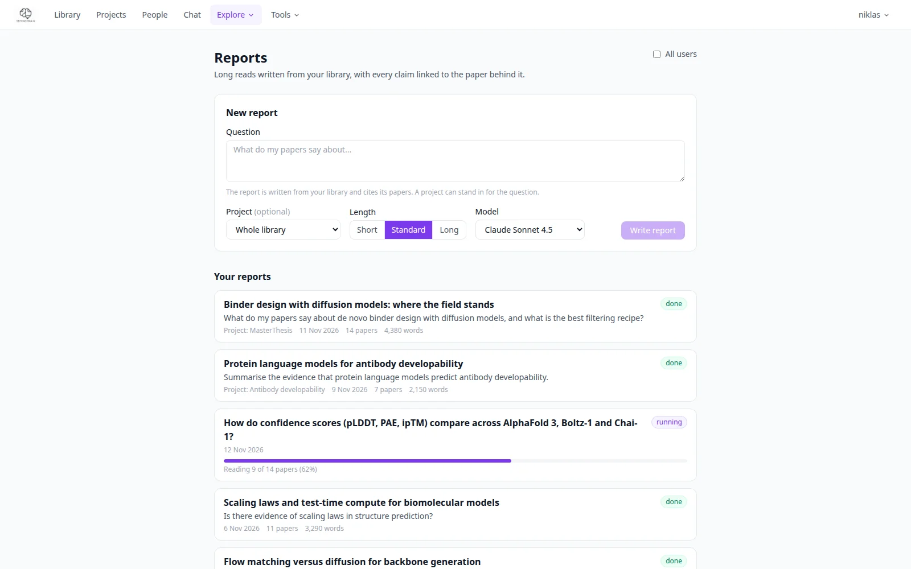
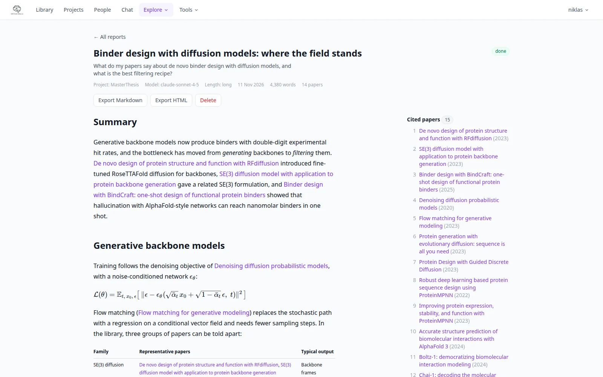

# Reports

A report is a long read written from your library: you ask a question (or pick a project), and
PaperManager reads the relevant papers, their summaries, claims, your notes and highlights and passages of
the full text, and writes a sectioned article that cites the papers it used. It runs in the background,
so you can leave the page. Open **Explore → Reports** (`/reports`).

{ .pm-shot }

## Writing a report

In **New report**:

1. Type a question, for example *What do my papers say about guidance in diffusion models?*
2. Optionally pick a **project** to restrict the report to its papers. A project alone, with no question,
   gives an overview of that project's literature. Leave it on *Whole library* to search everything.
3. Choose a **length**: Short (3 sections), Standard (5) or Long (7).
4. Choose the model if more than one is offered (the default is the server's fast model; Claude on your
   own key writes better prose and costs more).
5. Start it. The report appears in the list with a progress bar.

At most two reports are written at once on a server; the others wait as *queued*. **Cancel** (on the report page) stops one.
A server restart marks a running report as failed; start it again.

## Reading a report

Click a report to open it. While it runs, the page shows the progress and the steps taken so far (scope,
plan, evidence, sections, closing). The finished report has numbered sections, every claim followed by a
citation marker that links to the paper, and a **References** list in order of first citation. A side
panel lists the cited papers; a click opens the paper in your library.

{ .pm-shot }

!!! note "Written by a model"
    Reports are AI-written from your papers. Check a claim against its source before you rely on it;
    the HTML export says so in a note with the model and the date.

## Exporting

On the report page, **Export Markdown** and **Export HTML**; **Delete** removes the report:

- **Markdown**: one `.md` file, citations as links to your library.
- **HTML**: one self-contained page (styles inline, no external requests) that reads like an article, with
  the reference list linking to your library.

## Who sees a report

Reports are private to the user who made them; admins can see and delete everyone's. Deleting a paper
never deletes a report that cited it.

## Cost

Every step of a report is logged under the feature `reports` on the [Tokens](tokens.md) page. The pipeline
is described in [AI pipelines](../technical/ai-pipelines.md#reports).
