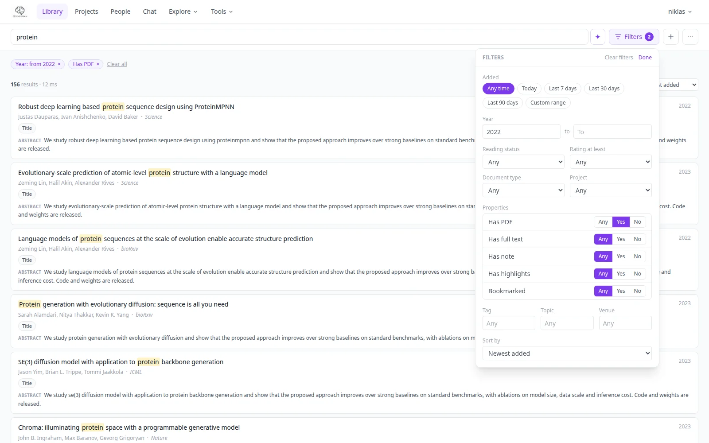

# Search and filters

The Library search box and its **Filters** popover narrow the library by date added, year, status,
properties and more. This page is the short version; [Library](library.md) has the full syntax, ranking
weights and the list of sorts.

{ .pm-shot }

## Find what you added

1. Click **Filters** next to the search box (a bottom sheet on a phone). Every change applies at once, with
   or without a search query.
2. Pick what you need, for example **Added: Last 7 days** and **Properties: Has PDF: No** to see what
   still needs a PDF.
3. Active filters show as removable chips under the box, with **Clear all**.

| Filter | Options |
|---|---|
| Added | Any time, Today, Last 7, 30 or 90 days, or a custom range |
| Year | from and to year of publication |
| Reading status | Unread (including papers without a status), Reading, Read |
| Rating at least | 1 to 5 stars |
| Document type | Paper, Book, Lecture deck, News article |
| Project | papers in one project |
| Properties | Has PDF, Has full text, Has note, Has highlights, Bookmarked: each Any, Yes or No |
| Tag, Topic, Venue | start typing and pick from your own names |
| Sort by | relevance, newest or oldest added, recently updated, year, title, rating, citations |

An author is picked in the search suggestions instead: type a name and choose the author.

## Everything is in the URL

The query and all filters are kept in the address bar, so a view can be bookmarked or sent to a teammate with
access to the same library: `/?added=7d&has_pdf=0`. Presets such as `added=7d` are relative
to the moment the page opens. The parameter list is in [Library](library.md#sharing-a-filtered-view).

## Speed

Browsing and filtering a large library is about two to three times faster than before: date, year and update
time are indexed in the database, the paper count and the page are fetched in parallel, and a result is
cached for 60 seconds, so paging or re-sorting the same search is served from memory. Any change you make
(adding, editing, deleting) clears the cache. A server owner can turn the cache off with
`LIBRARY_SEARCH_CACHE=0`. The API side is in the
[API reference](../technical/api-reference.md#search-query-parameters).

## The Library landing page

With no query and no filters the Library shows a header (*Library · N papers*), **Continue reading** (papers
you marked *Reading*) and **Recently added** cards. The bar on top stays in view while you scroll: search box,
**Filters** with a count badge, **+** to add papers, and a **⋯** menu with *Surprise me*, *Find research
gaps* and the tag, topic, author and project managers.
