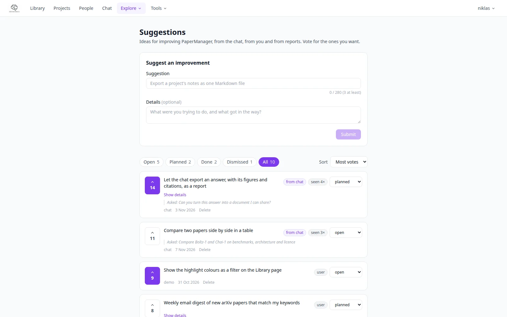

# Suggestions

**Explore → Suggestions** (`/suggestions`) is where improvements to PaperManager are collected: ideas the
[knowledge chat](chat.md) proposes, ideas you write yourself, and everyone's votes on them.

{ .pm-shot }

## Where suggestions come from

- **From the chat.** When a conversation shows that PaperManager lacks something you needed, the answer
  can end with a small chip with one concrete idea. The chip links here, has a vote button, and **×** hides it.
  If the same idea is already open or planned, the chat adds your vote and counts the repeat (*seen 3x*)
  instead of making a duplicate.
- **By hand.** Use **Suggest an improvement**: a short title (3 to 280 characters) and, optionally, what
  you were trying to do and what got in the way.

## Voting and status

Click the vote button to back a suggestion, click again to take the vote back. The tabs filter by status:
**Open**, **Planned**, **Done**, **Dismissed** or **All**; sort by most votes or newest. Only admins change
the status. The author or an admin can edit the text or delete a suggestion.

Suggestions are shared by everyone on the instance, because they are about the app and not about your
papers. A server owner can turn off recording of chat suggestions with `SUGGESTIONS_FROM_CHAT=false`.
