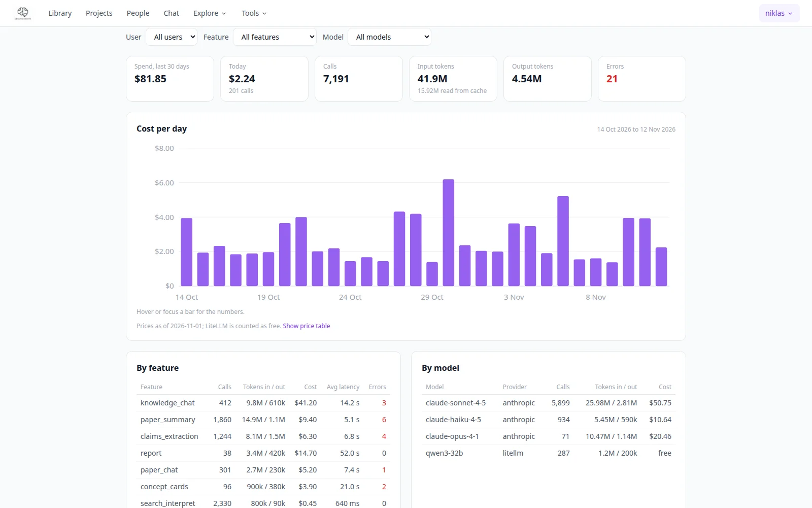

# Tokens

**Account menu → Tokens** (`/tokens`) shows what the language models behind PaperManager are used for and
what that costs at list price. Every model call the app makes is written to a ledger: summaries, topic
suggestions, claims, chat answers, concept cards, tours, researcher CVs, reports.

{ .pm-shot }

## What the page shows

Pick a time range (7, 30 or 90 days); admins can also narrow by user, feature or model.

- **Totals**: spend in the range, spend today, number of calls, input and output tokens (with how many were
  read from the prompt cache) and errors.
- **Cost per day** (per week for long ranges), as a bar chart.
- **By feature**, **by model** and, for admins, **by user**: calls, tokens and cost, most expensive first.
  A model that is not in the price table is flagged, and its calls count without a price.
- **Most expensive calls** and **most expensive papers**: where a bulk import or a long report went.
- **Recent calls**: the newest calls one by one, with feature, model, tokens, cost, latency and any error.
- **Prices**: the USD-per-million-token table the costs are computed from, and the date it was last updated.

Each user sees their own calls. Admins see everyone's.

## How costs are counted

- Anthropic and OpenAI calls are priced from the table, including cached-input discounts.
- Models on the self-hosted LiteLLM proxy cost 0 (your own hardware).
- Claude Code on a subscription is not billed per token; its list-price equivalent is shown separately
  and left out of the billed total.
- Streamed answers are recorded when they finish. If a provider reports no usage for a stream, the tokens
  are estimated from the text length and marked as estimated.

The ledger is a SQLite file kept next to the app's data, so it survives rebuilds and does not add nodes to
your graph. Recording can be switched off with `USAGE_LEDGER_ENABLED=false`; extra or changed prices go in
a JSON file named by `USAGE_PRICES_FILE`. See [Architecture](../technical/architecture.md#usage-ledger).

The [Health](health.md) page shows today's spend from the same ledger.
